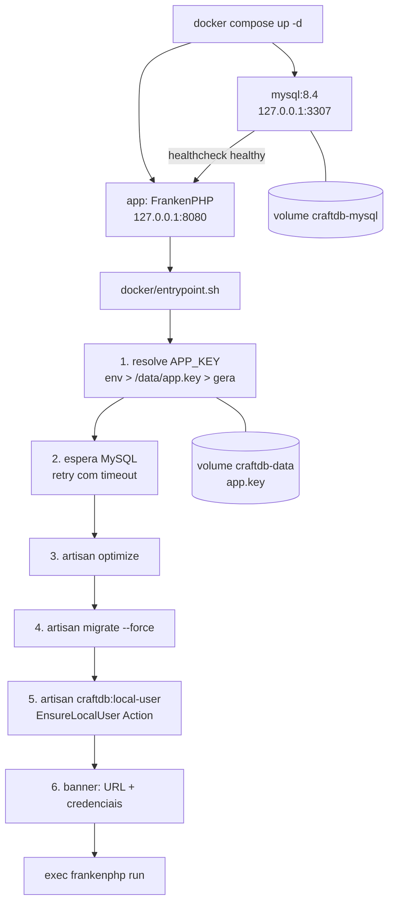

# F1 — Docker + MySQL + boot automático — Design

**Spec**: `.specs/features/2026-10-09-docker-local-boot/spec.md`
**Contexto**: `.specs/features/2026-10-09-docker-local-boot/context.md` (D1–D5 travadas)
**Status**: Approved (2026-10-20)

---

## Visão Geral da Arquitetura

Stack com dois serviços no `docker-compose.yml`. O `app` é uma imagem FrankenPHP de produção, com vendor e assets compilados no build. O boot é orquestrado por um **entrypoint shell fino** que delega a lógica de domínio (usuário local) para um **comando Artisan testável**.

**Abordagem escolhida (A — entrypoint + comando Artisan):**

| Abordagem | Prós | Contras |
|---|---|---|
| **A. Entrypoint shell + comando Artisan** ⭐ | Um container só; lógica de usuário local testável em Pest; segue padrão Action do projeto | Migrations rodam a cada restart do `app` (idempotente, custo ~1s) |
| B. Serviço `init` one-shot no compose (`service_completed_successfully`) | Separa boot de runtime; restart do app não re-roda migrate | 3º serviço, mais YAML, logs de credenciais ficam em outro serviço (`logs init`, contradiz DOCK-07 que pede `logs app`) |
| C. Tudo em shell (sem comando Artisan) | Zero PHP novo | Lógica de usuário em shell/tinker, não testável, frágil |

---

## Análise de Reuso

### Componentes Existentes

| Componente | Localização | Como Usar |
|---|---|---|
| `CreateNewTeam` Action | `app/Actions/Team/CreateNewTeam.php` | Criar o workspace do usuário local |
| Padrão de criação de usuário+time | `app/Actions/Fortify/CreateNewUser.php` | Referência (nome do time, transação) — não reusado direto porque valida senha forte e exige unicidade de e-mail |
| Cast `password => hashed` | `app/Models/User.php` | Passar senha em texto; o model faz hash |
| `Model::unguard()` | `AppServiceProvider::configureModels` | Permite `forceFill`/`create` com `email_verified_at` |
| Health route `/up` | `bootstrap/app.php` | Healthcheck do container (DOCK-18) |
| Script `composer setup` | `composer.json` | Referência da sequência de boot |
| Config `mysql` | `config/database.php` | Já lê `DB_*` do ambiente, utf8mb4 — nada a mudar |

### Pontos de Integração

| Sistema | Método de Integração |
|---|---|
| MySQL | Variáveis `DB_*` no `environment` do compose; host `mysql` |
| Laravel config | Sem `.env` na imagem; tudo via env do container + `config:cache` no boot |
| Super root (migrations) | Continua criado pelas migrations com `SUPER_ROOT_*`; usuário local é separado |

---

## Componentes

### 1. `Dockerfile` (raiz) — multi-stage
- **Propósito**: Imagem de produção do app, sem Node em runtime (DOCK-04).
- **Estágios**:
  1. `vendor` — `dunglas/frankenphp:1-php8.4-bookworm` + binário do `composer:2`; `composer install --no-dev --no-scripts --prefer-dist --optimize-autoloader`.
  2. `assets` — `node:22-bookworm-slim`; `npm ci`; copia `resources/`, `vite.config.js`, `tailwind.config.js` e `vendor/livewire/flux` (o `app.css` importa `vendor/livewire/flux/dist/flux.css`); `npm run build`.
  3. `app` — `dunglas/frankenphp:1-php8.4-bookworm`; `install-php-extensions pdo_mysql intl zip bcmath gd pcntl opcache`; copia código + `vendor` + `public/build`; `php artisan package:discover`; permissões em `storage/` e `bootstrap/cache/`.
- **Runtime**: `WORKDIR /app`, `SERVER_NAME=:80` (HTTP puro, sem auto-HTTPS do Caddy), `ENTRYPOINT ["docker/entrypoint.sh"]`, `CMD ["frankenphp","run","--config","/etc/frankenphp/Caddyfile"]` (caminho exato do Caddyfile confirmado na imagem durante Execute).
- **PHP 8.4**: Laravel 13 e dependências exigem `>=8.3` (composer.lock).

### 2. `.dockerignore`
- Exclui `.git`, `node_modules`, `vendor`, `.env*`, `storage/logs/*`, `storage/framework/{cache,sessions,views}/*`, `database/*.sqlite`, `tests`, `.specs`, `.cursor`, `_ide_helper.php`.

### 3. `docker-compose.yml` (raiz)
- **mysql**: `mysql:8.4` (LTS); `MYSQL_DATABASE=craftdb`, `MYSQL_USER=craftdb`, `MYSQL_PASSWORD=${CRAFTDB_DB_PASSWORD:-craftdb}`, `MYSQL_RANDOM_ROOT_PASSWORD=yes`; volume `craftdb-mysql:/var/lib/mysql`; porta `127.0.0.1:${CRAFTDB_DB_PORT:-3307}:3306`; healthcheck `mysqladmin ping -h 127.0.0.1` (TCP, ignora o servidor temporário de init).
- **app**: `build: .`; `depends_on: mysql: condition: service_healthy`; volume `craftdb-data:/data`; porta `127.0.0.1:${CRAFTDB_PORT:-8080}:80`; `restart: on-failure:3` (sem loop infinito — DOCK-05); healthcheck HTTP em `/up` via `php -r` (não depende de `curl` na imagem).
- **Env do app**: `APP_ENV=production`, `APP_DEBUG=false`, `APP_URL=http://localhost:${CRAFTDB_PORT:-8080}`, `APP_KEY=${CRAFTDB_APP_KEY:-}` (prefixo evita herdar o APP_KEY do `.env` de dev, que o compose lê automaticamente), `APP_FORCE_HTTPS=false`, `DB_CONNECTION=mysql`, `DB_HOST=mysql`, `DB_DATABASE/USERNAME=craftdb`, `DB_PASSWORD=${CRAFTDB_DB_PASSWORD:-craftdb}`, `LOG_CHANNEL=stderr`, `SESSION_DRIVER=database`, `CACHE_STORE=database`, `QUEUE_CONNECTION=sync`, `MAIL_MAILER=log`, `NIGHTWATCH_ENABLED=false`, `CRAFTDB_USER_EMAIL`, `CRAFTDB_USER_PASSWORD` (pass-through).

### 4. `docker/entrypoint.sh`
- **Propósito**: Boot idempotente; falha = exit ≠ 0 com causa no log (DOCK-05).
- **Passos** (`set -euo pipefail`):
  1. `APP_KEY`: se vazio no env → lê `/data/app.key`; se não existe → `php artisan key:generate --show` → grava em `/data/app.key` (chmod 600). Exporta. (DOCK-12)
  2. Espera o MySQL: loop PDO via `php -r`, até 60s; estoura com mensagem clara. (DOCK-02)
  3. `php artisan optimize` (config/route/view cache — config depende do `APP_KEY` já exportado).
  4. `php artisan migrate --force`. (DOCK-03)
  5. `php artisan craftdb:local-user`. (DOCK-06/07/08/10)
  6. `exec "$@"`.

### 5. `config/craftdb.php` (novo)
- `local_user.email` ← `env('CRAFTDB_USER_EMAIL', 'local@craftdb.local')`
- `local_user.password` ← `env('CRAFTDB_USER_PASSWORD', 'craftdb')`
- `force_https` ← `env('APP_FORCE_HTTPS', true)` — ver Decisão T1.

### 6. `App\Actions\Local\EnsureLocalUser` (novo)
- **Propósito**: Garantir que o usuário local existe, verificado e com workspace — idempotente.
- **Interface**: `exec(string $email, string $password): array{user: User, created: bool}`
- **Regras**:
  - Busca por e-mail. Não existe → cria (`name: 'Local'`, senha via cast hashed), `created = true`.
  - Existe (inclusive super root com mesmo e-mail) → **não altera senha** (DOCK-08), `created = false`.
  - Em ambos: se `email_verified_at` nulo → marca agora; se não possui time → cria via `CreateNewTeam` (`name: 'Local Workspace'`).
  - Tudo em `DB::transaction`.
- **Reusa**: `CreateNewTeam`, cast `hashed` do `User`.

### 7. `App\Console\Commands\EnsureLocalUserCommand` (novo)
- **Assinatura**: `craftdb:local-user`
- Lê `config('craftdb.local_user.*')`, chama a Action, imprime banner: URL (`config('app.url')`), e-mail, e **senha somente quando `created`** (nos boots seguintes: "senha inalterada"). (DOCK-07)

### 8. `AppServiceProvider::boot` (ajuste)
- Trocar `if (! $app->environment(['local', 'testing']))` por checar `config('craftdb.force_https')` combinado ao ambiente — ver Decisão T1.

### 9. `docker/smoke-test.sh` (novo, verificação)
- Script de evidência para os critérios de infra: HTTP 200 em `/login` (DOCK-01), `ps` healthy (DOCK-18), portas só em `127.0.0.1` (DOCK-15), conexão MySQL em 3307 (DOCK-14), persistência após `down/up` (DOCK-11), reset com `down -v` (DOCK-13). Rodado no Execute; não entra na suite Pest.

### 10. Docs
- `docs/README.md` (+ `docs/README.en.md`): seção "Rodando com Docker" (DOCK-17).

---

## Modelos de Dados

Nenhuma tabela nova. Usa `users` (`email_verified_at`) e `team` existentes.

---

## Tratamento de Erros

| Cenário | Tratamento | Impacto no Usuário |
|---|---|---|
| MySQL não sobe em 60s | entrypoint aborta com "MySQL indisponível em mysql:3306" | `app` sai com erro; `logs app` mostra a causa; até 3 restarts |
| Migration falha em MySQL | `set -e` propaga exit ≠ 0 | Erro SQL no `logs app` |
| Porta 8080/3307 ocupada | Erro do próprio Docker | README explica `CRAFTDB_PORT`/`CRAFTDB_DB_PORT` |
| `/data/app.key` apagado com banco existente | Gera nova chave | Sessões antigas inválidas (aceito na spec) |
| E-mail do usuário local = e-mail existente | Reaproveita usuário, verifica e garante time | Login com a senha já existente |

---

## Decisões Técnicas (apenas não-óbvias)

| # | Decisão | Escolha | Justificativa |
|---|---|---|---|
| T1 | HTTPS forçado fora de local/testing | Flag `APP_FORCE_HTTPS` (default `true`, compose seta `false`) | `AppServiceProvider` faz `URL::forceHttps()` em production — quebraria `http://localhost`. Flag mantém o SaaS intacto. Alternativa: `APP_ENV=local` no container (rejeitada: liga comportamentos de dev e desliga `prohibitDestructiveCommands`) |
| T2 | Sem `.env` na imagem | Env do container + `config:cache` no boot | Config cache lê env real; evita arquivo com segredo na imagem |
| T3 | `APP_KEY` em volume próprio `/data` | Arquivo `app.key` | Persistir `storage/` inteiro mascararia arquivos da imagem em upgrades |
| T4 | MySQL 8.4 LTS | `mysql:8.4` | Suporte longo; migrations nunca validadas em MySQL — validação via DOCK-03 |
| T5 | Healthcheck com `php -r` | sem `curl` | Não assumir binários na imagem base |
| T6 | `QUEUE_CONNECTION=sync` | sem worker | Não há jobs `ShouldQueue` (context.md) |

---

## Riscos

- **Migrations em MySQL**: 33 migrations nunca rodaram em MySQL; possíveis ajustes (ordem de FKs, tamanhos de índice). Mitigação: rodar cedo no Execute.
- **Build de assets em arm64 (Apple Silicon)**: `optionalDependencies` fixam binários `linux-x64-gnu` (rollup 4.9.5). Mitigação: validar `npm ci && npm run build` no estágio `assets` cedo; se falhar, ajustar o `package.json`.
- **Dependências de dev referenciadas em runtime** (`--no-dev`): verificar no primeiro boot (debugbar/ide-helper não aparecem no `AppServiceProvider`).

---

## Reuse Validation

**Componentes reusáveis identificados:**
- `app/Actions/Team/CreateNewTeam.php` — criar workspace — usado em: EnsureLocalUser
- `app/Models/User.php` (cast `hashed`) — hash de senha — usado em: EnsureLocalUser
- `bootstrap/app.php` (`/up`) — healthcheck — usado em: docker-compose
- `config/database.php` (`mysql`) — conexão — usado em: compose env

**Padrões reusáveis identificados:**
- Padrão Action (`app/Actions/<Domínio>/`) — aplicado em: `EnsureLocalUser`
- Comando Artisan (`app/Console/Commands/`) — aplicado em: `EnsureLocalUserCommand`

**Áreas exploradas SEM reuso (justificativa):**
- `CreateNewUser` (Fortify) — valida senha forte e exige e-mail único; o usuário local precisa de senha simples padrão e reaproveitar e-mail existente
- `DatabaseSeeder` — usa factories (Faker é dev-only, ausente na imagem `--no-dev`)

**Áreas NÃO exploradas:**
- (vazio)
