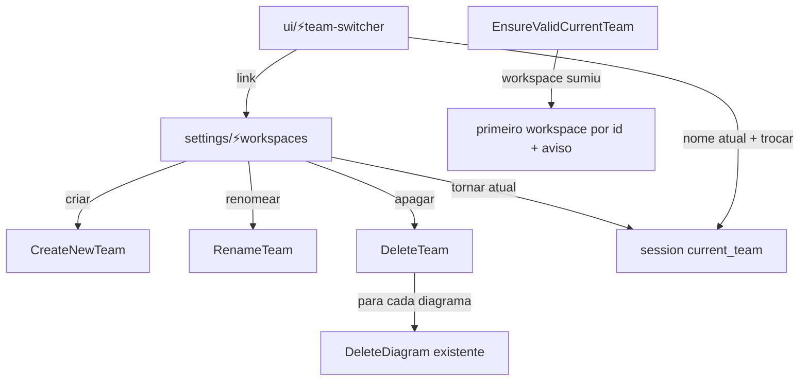

# F4 — Workspaces locais — Design

**Spec**: `spec.md` · **Contexto**: `context.md` (D1–D6, A1–A8 — Lead, dev ausente)
**Status**: Approved (Lead, dev ausente — 2026-10-21)

## Visão Geral

Model `Team` fica; a UI passa a falar em **Workspace**. Uma tela Livewire única (`settings/workspaces`) concentra criar/renomear/apagar/tornar atual, usando Actions (`CreateNewTeam` existente + `RenameTeam` e `DeleteTeam` novas). O pivot de membros sai (código + tabela `team_user`); acesso é sempre por posse (`ownsTeam`).

### Abordagens

| Abordagem | Prós | Contras |
|---|---|---|
| **A. Tela única de lista com ações por linha + Actions** ⭐ | Um lugar para tudo; testável via Actions; segue padrão do projeto | Componente Livewire maior |
| B. Manter telas por time atual (editar/criar) + botão apagar | Menos mudança | Não lista workspaces; renomear só o atual; contraria D2 |

## Componentes

### `App\Actions\Team\RenameTeam` (novo)
- `exec(Team $team, string $name): Team` — valida `required|string|max:255`, salva.

### `App\Actions\Team\DeleteTeam` (novo)
- `exec(Team $team): void` — em `DB::transaction`: recusa (lança `ValidationException` com chave `team`) se `$team->owner->ownedTeams()->count() <= 1`; para cada `$team->diagrams` chama `DeleteDiagram::exec`; apaga o team.
- Reusa `App\Actions\Diagram\DeleteDiagram` (já apaga relationships, columns, tables, areas, notes e o diagrama; `diagram_views` cai por cascade).

### `resources/views/components/settings/⚡workspaces.blade.php` (novo, Livewire SFC)
- Rota `settings/workspaces` → `settings.workspaces`, nome `workspaces.index` (dentro do grupo `auth` de settings).
- Lista `auth()->user()->ownedTeams()->withCount('diagrams')->orderBy('name')`; marca o atual (`Team::currentTeam()?->id`).
- Ações: `create()` (input nome → `CreateNewTeam`, vira atual), `startRename(id)`/`rename()` (inline), `confirmDelete(id)` (modal Flux pedindo digitar o nome) → `delete()` (`DeleteTeam`; se era o atual, `session(['current_team' => primeiro por id])`), `makeCurrent(id)` → sessão + redirect dashboard.
- Todas as ações autorizam `ownsTeam` via `TeamPolicy::updateTeam` (renomeado para `update`) e novo `delete`.
- Substitui `settings/⚡team.blade.php` e `settings/team/⚡create.blade.php` (apagados com suas rotas `team.edit`/`team.create`).

### `ui/⚡team-switcher` (ajuste)
- Sempre visível; mostra o nome do workspace atual; lista os outros; item "Gerenciar workspaces" → `workspaces.index`. `switchTeam` só considera `ownedTeams`. Sem cache de contagem na sessão.

### `EnsureValidCurrentTeam` / `SetCurrentTeamOnLogin` (ajuste)
- Fallback único: `ownedTeams()->orderBy('id')->first()`; mensagem "O workspace atual não existe mais. Mudamos para :name." (traduzível).

### Membros (remoção)
- Migration `2026_10_21_000003_drop_team_user_table.php` (`dropIfExists('team_user')`; `down()` recria sem `role_id`).
- `HasTeams`: remove `teams()`, `belongsToTeam()`; `allTeams()` = `ownedTeams()->orderBy('name')->get()`.
- `HasMembers`: remove `users()`, `hasUser()` (fica `owner()`). Apaga `Membership`.
- `DiagramPolicy::view`, `TeamPolicy::view`, `TableAccessible`, `Column::accessible` → posse.

### Diagramas em qualquer workspace
- `⚡note/note.php` e `AddRelationship`: trocar "time do diagrama == time atual" por "usuário é dono do time do diagrama".
- `layouts/app/master.blade.php` breadcrumb e `⚡create` (link pós-criação): usar `$diagram->team_id`/time escolhido.
- Dashboard: chave do cache de contagem inclui o id do workspace; `toggleFavorite` autoriza `update` do diagrama.
- Remove rota `/my-favorites` + `App\Livewire\MyFavorites`.

### Textos
- Todas as strings de UI "Team/Time/Equipe" → "Workspace(s)"; nav de settings "Workspaces"; `lang/pt_BR.json` com chaves novas e sem as mortas (membros/convites/papéis).

## Tratamento de Erros

| Cenário | Tratamento | Impacto |
|---|---|---|
| Apagar último workspace | `ValidationException` (`team`) | Mensagem na tela, nada apagado |
| Nome de confirmação errado | Validação no componente | Modal mostra erro |
| Workspace atual sumiu | Middleware troca e avisa | Dashboard do primeiro workspace |

## Decisões Técnicas

| # | Decisão | Escolha | Justificativa |
|---|---|---|---|
| T1 | Delete em cascata | Loop em `DeleteDiagram` dentro de transação | FKs não têm cascade; reusa lógica testada |
| T2 | `TeamPolicy` | `view`/`update`/`delete` = `ownsTeam` | Sem membros |
| T3 | Sessão | Continua guardando o model (como hoje) | Mudar para id é refactor fora do escopo |

## Riscos
- Muitos lugares chamam `allTeams()` (MCP, authorize view) — semântica muda só por não ter mais pivot (mesmo resultado para o usuário local).
- `RemoveAuthLeftoversTest` afirma `team_user` existente → atualizar.

## Reuse Validation
**Reusáveis:** `CreateNewTeam`, `DeleteDiagram`, `TeamPolicy`, switcher existente, `TestCase::autenticated()`.
**Padrões:** Actions com `exec()`, Livewire SFC em `components/settings`, migration de limpeza (F2/F3).
**Sem reuso:** pivot/membros — removidos.
**Não exploradas:** (vazio)
