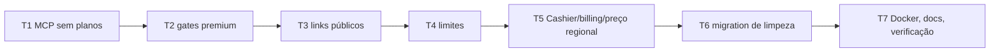

# F3 — Remoção de billing, limites e links públicos — Design

**Spec**: `.specs/features/2026-10-21-remove-billing-limits/spec.md`
**Contexto**: `context.md` (D1–D7, A1–A6 — Lead, dev ausente)
**Status**: Approved (Lead, dev ausente — 2026-10-21)

---

## Visão Geral

A F3 é **remoção**: não há componente novo. A ordem importa porque `isPro`/`isTeamPlan`/`hasDiagramPremiumAccess` (que dependem do `Billable` do Cashier) são usados por gates, limites e MCP. Primeiro removem-se os **consumidores** (gates premium, limites, MCP), depois o **provedor** (Cashier/billing), depois links públicos e por fim o schema.

### Abordagens consideradas

| Abordagem | Prós | Contras |
|---|---|---|
| **A. Remoção total, consumidores antes do provedor** ⭐ | Suite verde a cada task; schema e código coerentes | Muitos arquivos por task |
| B. Fazer `isPro()` retornar `true` e limites `PHP_INT_MAX` | Diff pequeno | Mantém Cashier, configs e UI mortos; contraria D1–D3 |

### Abordagem do schema

Mesma da F2 (D6 da F2): **migration nova de limpeza** `2026_10_21_000002_remove_billing_leftovers.php`; migrations antigas intactas. Ordem: `dropUnique(['public_token'])` → `dropColumn('public_token')` em `diagram`; `dropIndex(['stripe_id'])` → `dropColumn([stripe_id, pm_type, pm_last_four, trial_ends_at])` em `users`; `dropIfExists('subscription_items')` → `dropIfExists('subscriptions')`. `down()` aproximado (como na F2).

---

## Análise de Reuso

| Componente | Localização | Como Usar |
|---|---|---|
| `AuthorizationException` | Laravel | Substitui `PlanFeatureException` na checagem token↔time do MCP (`CraftdbCallTool` já captura) |
| Padrão de migration de limpeza | `database/migrations/2026_10_21_000001_remove_auth_leftovers.php` | Mesmo formato (dropIndex antes de dropColumn; `down()` aproximado comentado) |
| `docker/smoke-test.sh` | F1/F2 | Usado na T7 sobre volume existente |
| `TestCase::autenticated()` | `tests/TestCase.php` | Testes sem assinatura |

---

## Componentes (o que muda)

### T1 — Gates premium
- `CreateNewDiagram`, `ImportToExistingDiagram`: removem checagem premium (e o delete+throw).
- `DiagramController::exportJson/exportLaravelMigration`: removem `abort(403)` por plano (mantêm `Gate::authorize('view')`).
- `ExportDiagramToJson`, `ExportDiagramToLaravelMigration`: removem gate e bypass `testing` (A4).
- Livewire/Blade: `⚡export` (`canExport`), `⚡graph`, `⚡area-list`, `⚡note-list`, `controls.blade.php`, `topbar.blade.php` (import/export), `card/index.blade.php`, `create-step-2.blade.php`: mostram sempre os recursos.
- Apaga `pro-feature-modal`, `config/pro-features.php`, store Alpine (`resources/js/app.js`), listeners `pro-feature::show` nos layouts.
- `TeamPolicy::create` → `return true;` (D7).
- `User`: remove `hasDiagramPremiumAccess`, `hasTeamWorkspacePremiumAccess` (inclui o bloco "invited members inherit" — item do STATE), `canCreateTeam`.

### T2 — Limites
- Apaga `app/Support/DiagramLimits.php`, `DiagramLimitExceededException`, `TableLimitExceededException`, `TableColumnLimitExceededException`, `canvas/ui/⚡limit/`, `Diagram::TABLE_LIMIT`.
- `config/diagram.php`: remove chaves de limite por plano (se o arquivo ficar vazio, apagar e remover usos).
- `User`: remove `hasReachedDiagramLimit`, `validateDiagramLimit`.
- `BaseComponent` e `CanvasComponent`: removem `catch` de limites e `validateTableLimit()`; callers (`table-list.php` n:n e addTable, `import.php`) sem validação.
- `⚡table` (`tableColumnsLimit` + check em addColumn), `AddColumnToTable`, `ParseLaravelMigration`, `ParseMySQLSchema`, `CreateNewDiagram`/`ImportToExistingDiagram` (catch de `TableLimit`), `⚡create` (`validateDiagramLimit`).
- Footers `canvas/_partials/table/footer.blade.php` (e o público, removido na T5): sem "X / limite", mostram só a contagem.

### T3 — MCP sem planos
- `McpAccess`: remove `assertWorkspacePremium` e checagem de limite; `premiumTeamIdsForUser` → `teamIdsForUser` (times do usuário ∩ `mcp_token_teams`); `assertTokenAllowsTeam` lança `AuthorizationException`.
- `ListDiagramsTool`, `ListTeamsTool` (sem label de plano/contagem vs limite/aviso/URL de upgrade), `CraftdbServer` (instruções sem Free/Pro/Team), `CraftdbCallTool` (sem `PlanFeatureException|DiagramLimitExceededException`), `mcp/authorize.blade.php` (sem badge).
- Apaga `PlanFeatureException`.

### T4 — Cashier, billing e preço regional
- `composer remove laravel/cashier`; apaga `config/cashier.php`, `config/billing.php`, `BillingController`, `settings/⚡billing`, rotas `billing.*`, `BillingCountry`, `SetHeaders` (+ registro), `config('app.cloudflare_proxy')`, `/debug-cf`, `Helpers::formatPriceAmount`, `BillingSubscriptionFactory`, `UserFactory::withActiveProSubscription`.
- `User`: remove `Billable`, `isPro`, `isTeamPlan`, caches e `clearSubscriptionCaches` (+ `TestCase::setUp`).
- Remove links "Billing" (settings layout, master, header ×2, topbar) e badge de plano (`master.blade.php:38-58`); `EnsureValidCurrentTeam` sem isenção `billing.*`.
- `.env.example`: remove `STRIPE_*`, `BILLING_*`, `CLOUDFLARE_PROXY`.

### T5 — Links públicos
- Apaga rota `diagram.public`, `DiagramController::showPublic`, `pages/diagram/public.blade.php`, `DiagramPolicy::share`, métodos públicos de `Diagram`, `PublicCanvas`, `CanvasPublic` (+ registro em `AppServiceProvider`), `layouts/canvas/public.blade.php`, `components/diagram/public/**`, `canvas-public.css` (+ `vite.config.js`), referência em `_svg-lines.js:65`, `docs/PUBLIC_SHARING.md`.
- `⚡share`: removido; o dropdown "Compartilhar" do `topbar` mantém copiar link interno + slug (remover o embed e o listener órfão `share::public-url-generated`).

### T6 — Migration de limpeza (ver "Abordagem do schema")

### T7 — Docker, docs, verificação
- Migrar sobre volume existente com diagrama marcado (FREE-18), smoke, README (partes Stripe), docs do codebase na fase Docs.

---

## Tratamento de Erros

| Cenário | Tratamento | Impacto |
|---|---|---|
| Token MCP sem o time | `AuthorizationException` → `CraftdbCallTool` devolve erro de autorização | Igual a hoje, mensagem sem "upgrade" |
| Banco antigo com `public_token` / assinaturas | Migration apaga | Nenhum dado de diagrama perdido |

## Decisões Técnicas

| # | Decisão | Escolha | Justificativa |
|---|---|---|---|
| T1 | Ordem das tasks | Consumidores → provedor | `isPro` etc. somem só quando ninguém mais chama; suite verde a cada task |
| T2 | Erro token↔time no MCP | `AuthorizationException` | Já tratado pelo `CraftdbCallTool`; sem classe nova |
| T3 | `config/diagram.php` | Remover limites; apagar arquivo se vazio | Sem limites (D2) |

## Riscos

- **Blade com `@if(isPro())`/gates espalhados**: mitigação — grep de verificação ao fim de cada task.
- **Testes colocados em `resources/views/**.test.php`** criavam assinaturas no `beforeEach`: precisam ser ajustados na task que remove o gate correspondente.
- **`_svg-lines.js`** depende do nome do componente público: remover a condição sem quebrar o canvas privado.

## Reuse Validation

**Componentes reusáveis identificados:** `AuthorizationException` (T3), padrão de migration da F2 (T6), smoke test (T7), `TestCase::autenticated()` (testes).
**Padrões reusáveis:** remoção consumidor → provedor (F2).
**Áreas exploradas SEM reuso:** Cashier/Billable — removidos por definição.
**Áreas NÃO exploradas:** (vazio)
