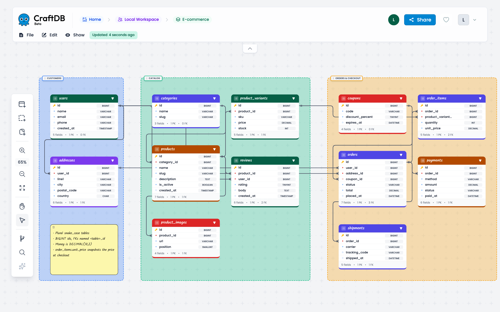
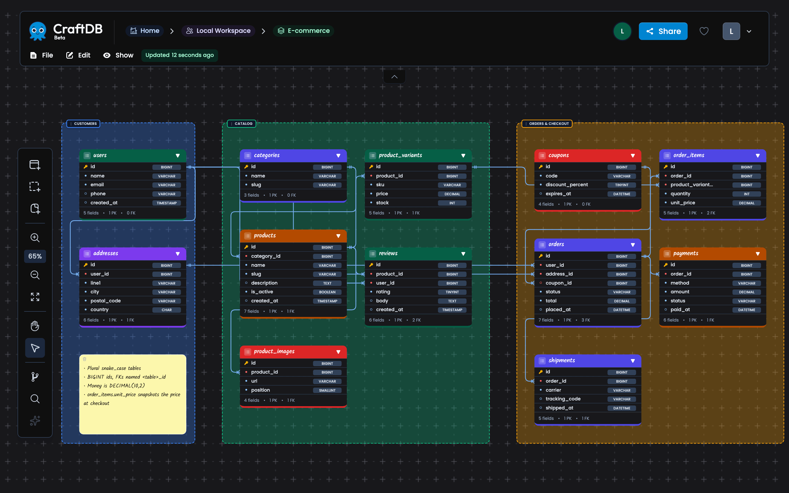
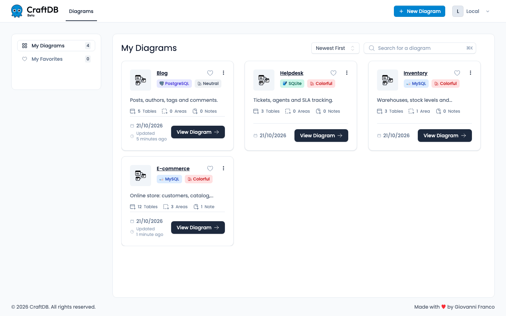
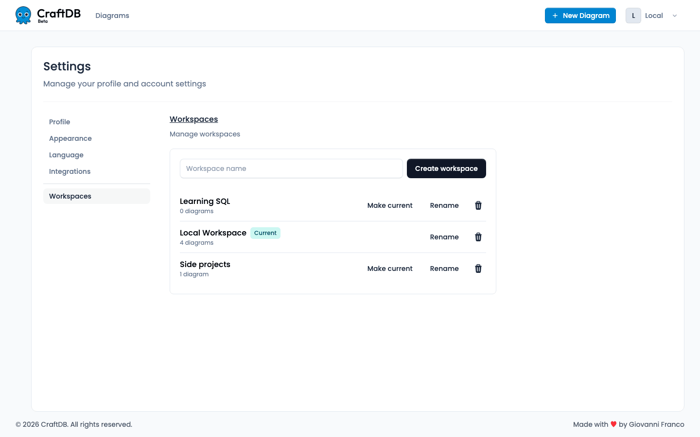
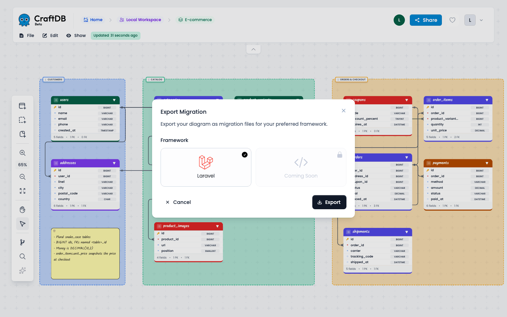
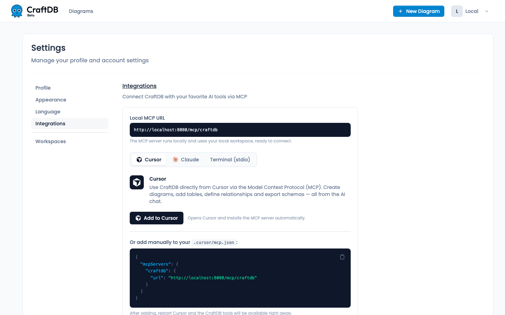

<p align="center">
  
</p>

<h1 align="center">CraftDB</h1>

<p align="center">
  <strong>Desenhe seu banco de dados visualmente. 100% local, sem conta, sem telemetria.</strong>
</p>

<p align="center">
  <a href="LICENSE"></a>
  
  
  
</p>

<p align="center">
  <a href="README.md">🇺🇸 English</a> · 🇧🇷 Português
</p>



O CraftDB é um editor de diagramas de banco de dados open source. Desenhe tabelas, colunas e relacionamentos em um canvas infinito, organize tudo em áreas e depois exporte migrations Laravel ou deixe seu assistente de IA montar o schema por você via MCP. Ele roda na sua máquina com um único `docker compose up`.

## ✨ Por que o CraftDB

- 🏠 **100% local.** Roda no seu computador com Docker. Seus schemas ficam no seu próprio MySQL.
- 🔓 **Sem conta, sem login.** Abra o navegador e comece a desenhar.
- 🙈 **Zero telemetria.** Sem analytics, sem rastreamento, sem chamadas a serviços externos. Até as fontes vêm embutidas.
- 💸 **Grátis e open source.** Todos os recursos estão disponíveis para todo mundo, sob a licença AGPL-3.0.
- 🤖 **Pronto para IA.** Um servidor MCP embutido deixa o Claude Code, o Cursor e outros assistentes criarem e editarem diagramas.

## 🧩 Recursos

### Editor visual

Crie tabelas, adicione colunas tipadas (chaves primárias, nulidade, valores padrão, tamanhos) e ligue tudo com relacionamentos **1:1, 1:n, n:1 e n:n**. O CraftDB cria as colunas de chave estrangeira para você e, no n:n, cria também a tabela pivô. Dê zoom, arraste e navegue livremente pelo canvas infinito.

### Áreas e notas

Agrupe tabelas relacionadas em **áreas** coloridas (como *Customers*, *Catalog* e *Orders* acima) e deixe **notas** com convenções, decisões ou TODOs ao lado do schema.

### Tema escuro



### Dashboard e workspaces

Todo diagrama pertence a um **workspace**. Use workspaces para separar trabalho, projetos pessoais ou clientes. Busque, ordene e favorite diagramas no dashboard.





### Importação

Comece do que você já tem:

- **Dump SQL** (`.sql`, MySQL)
- **Migrations Laravel** (um arquivo `.php` ou um `.zip` com a sua pasta `database/migrations`)

### Exportação

| Formato | No app | Via MCP |
|---|:---:|:---:|
| Migrations Laravel (`.zip`, um arquivo por tabela) | ✅ | ✅ |
| JSON | ✅ | ✅ |
| Diagrama ER em Mermaid | | ✅ |



Esta é a migration real de `orders` gerada a partir do diagrama acima:

```php
Schema::create('orders', function (Blueprint $table) {
    $table->id();
    $table->foreignId('user_id')->constrained('users');
    $table->foreignId('address_id')->constrained('addresses');
    $table->foreignId('coupon_id')->nullable()->constrained('coupons');
    $table->string('status', 20)->default('pending');
    $table->decimal('total');
    $table->dateTime('placed_at')->nullable();
});
```

### MCP para assistentes de IA

O CraftDB traz um servidor [MCP](https://modelcontextprotocol.io) com 27 ferramentas: crie schemas inteiros em uma chamada, adicione tabelas e colunas, ligue relacionamentos, adicione áreas e notas, mova tabelas e exporte. Depois de conectar (veja [Conecte seu assistente de IA](#-conecte-seu-assistente-de-ia)), é só pedir:

> Usando o MCP do craftdb, crie um diagrama chamado "Helpdesk" no meu Local Workspace com clientes, atendentes, tickets, respostas e tags. Agrupe em áreas, adicione os relacionamentos e deixe uma nota explicando os status do ticket.

O diagrama de e-commerce das imagens foi criado exatamente assim.

## 🚀 Começo rápido

Você só precisa do [Docker](https://docs.docker.com/get-docker/) com Compose v2.

```bash
git clone https://gitlab.com/giovannirz/craftdb.git
cd craftdb
docker compose up -d --build
```

Abra **http://localhost:8080**. Pronto: sem cadastro, sem login, você cai direto no seu dashboard.

O primeiro build leva alguns minutos. Os próximos starts levam segundos. Para parar:

```bash
docker compose down        # para os containers e mantém seus dados
```

> 🔒 O app e o MySQL escutam só em `127.0.0.1`, então nada fica exposto na sua rede.

## 🤖 Conecte seu assistente de IA

O servidor MCP roda em `http://localhost:8080/mcp/craftdb`. Ele não precisa de token: age como o seu usuário local e só aceita requisições locais.

**Claude Code**

```bash
claude mcp add --transport http craftdb http://localhost:8080/mcp/craftdb
```

**Cursor**: adicione isto ao `.cursor/mcp.json` (ou clique em *Add to Cursor* no app):

```json
{
  "mcpServers": {
    "craftdb": {
      "url": "http://localhost:8080/mcp/craftdb"
    }
  }
}
```

**Qualquer cliente que use stdio**

```bash
docker compose exec -T app php artisan mcp:start craftdb
```

Os trechos prontos para Cursor, Claude e terminal também estão em **Configurações → Integrações**.



## ⚙️ Configuração

Os valores padrão já funcionam. Para mudar algo, crie um arquivo `.env` ao lado do `docker-compose.yml` (ou defina as variáveis no seu shell) e rode `docker compose up -d` de novo.

| Variável | Padrão | O que faz |
|---|---|---|
| `CRAFTDB_PORT` | `8080` | Porta do app web (e da URL do MCP) |
| `CRAFTDB_DB_PORT` | `3307` | Porta do MySQL em `127.0.0.1`, para o seu cliente SQL favorito |
| `CRAFTDB_DB_PASSWORD` | `craftdb` | Senha do MySQL (aplicada só no primeiro boot) |
| `CRAFTDB_USER_EMAIL` | `local@craftdb.local` | E-mail do usuário local (só no primeiro boot) |
| `CRAFTDB_APP_KEY` | gerada no primeiro boot | Chave da aplicação. Se vazia, uma chave é gerada e guardada no volume `craftdb-data` |

Exemplo:

```bash
# .env
CRAFTDB_PORT=8090
```

> As variáveis usam o prefixo `CRAFTDB_` de propósito: o Docker Compose também lê esse `.env`, que o Laravel usa no desenvolvimento local.

### Links da página de apoio

A página **Apoiar** (`/support`) mostra só os links que você preencher. Todos são opcionais e vêm vazios por padrão:

| Variável | Mostra |
|---|---|
| `CRAFTDB_SUPPORT_REPO_URL` | Botão para dar estrela no repositório |
| `CRAFTDB_SUPPORT_GITHUB_SPONSORS_URL` | Botão do GitHub Sponsors |
| `CRAFTDB_SUPPORT_KOFI_URL` | Botão do Ko-fi |
| `CRAFTDB_SUPPORT_BUYMEACOFFEE_URL` | Botão do Buy Me a Coffee |
| `CRAFTDB_SUPPORT_PIX_KEY` | Chave Pix com botão de copiar |

As URLs precisam começar com `http://` ou `https://`. Adicione as variáveis no mesmo `.env` e rode `docker compose up -d` para aplicar:

```bash
# .env
CRAFTDB_SUPPORT_REPO_URL=https://gitlab.com/giovannirz/craftdb
CRAFTDB_SUPPORT_BUYMEACOFFEE_URL=https://buymeacoffee.com/sua-pagina
```

Você pode se conectar ao banco com qualquer cliente SQL: host `127.0.0.1`, porta `3307`, banco `craftdb`, usuário `craftdb`, senha `craftdb`.

## 🔄 Atualização e backup

**Atualize para a versão mais recente.** As migrations do banco rodam sozinhas no boot.

```bash
git pull
docker compose up -d --build
```

**Faça backup** dos seus diagramas em um arquivo SQL:

```bash
docker compose exec -T mysql sh -c 'exec mysqldump --no-tablespaces -u craftdb -p"$MYSQL_PASSWORD" craftdb' > craftdb-backup.sql
```

**Restaure** um backup:

```bash
docker compose exec -T mysql sh -c 'exec mysql -u craftdb -p"$MYSQL_PASSWORD" craftdb' < craftdb-backup.sql
```

Seus dados ficam em dois volumes do Docker, `craftdb-mysql` (banco) e `craftdb-data` (chave do app). O `docker compose down` mantém os dois. O `docker compose down -v` **apaga os dois**, então faça um backup antes.

## 🗺️ Roadmap

Próximo passo (M2, distribuição): instalar e atualizar sem clonar o repositório.

- 📦 Imagem Docker multi-arch em um registry público
- 🍺 Uma CLI `craftdb` via Homebrew (`start`, `stop`, `update`, `backup`)
- 💾 Backup automático do banco antes das migrations

Ideias para depois: um modo lite com SQLite, multiusuário em rede local e parsers de importação para PostgreSQL e SQLite.

## 💜 Apoie

O CraftDB é gratuito e feito nas horas vagas. Se ele te poupa tempo, você pode:

- ⭐ Dar uma estrela no repositório e indicar para alguém
- 🐛 Reportar bugs e sugerir recursos nas [issues](https://gitlab.com/giovannirz/craftdb/-/issues)
- ☕ Me pagar um café (link em breve)
<!-- TODO: adicionar aqui (e no README.md) o link do Buy Me a Coffee quando a página existir -->

O app também tem uma página **Apoiar** em `/support`.

## 🤝 Contribuindo

Contribuições são bem-vindas! Abra uma [issue](https://gitlab.com/giovannirz/craftdb/-/issues) para discutir mudanças maiores antes de mandar um merge request.

Para mexer no código sem Docker você precisa de PHP 8.2+, Composer e Node.js:

```bash
composer setup     # instala dependências, cria o .env, roda as migrations e builda os assets
composer run dev   # servidor do app, fila, logs e Vite
composer test      # suíte de testes (Pest)
```

Arquitetura, estrutura do projeto e o smoke test do Docker estão em [docs/DEVELOPMENT.md](docs/DEVELOPMENT.md) (em inglês).

## 📝 Licença

O CraftDB é distribuído sob a [GNU Affero General Public License v3.0](LICENSE) (AGPL-3.0-or-later).

Feito com ❤️ por **Giovanni Franco Rezende**.
